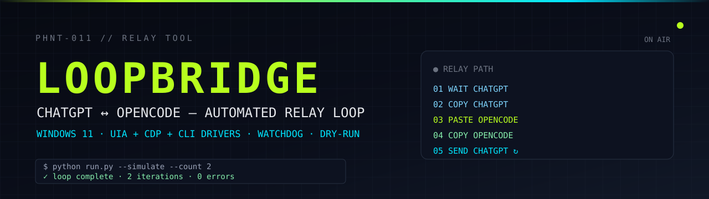
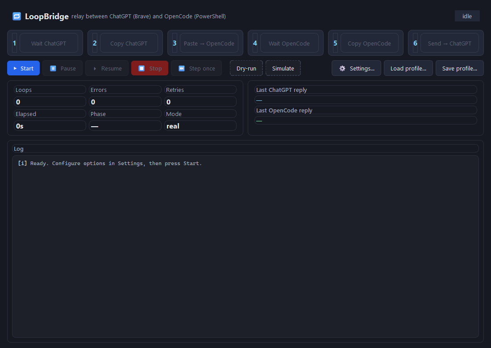
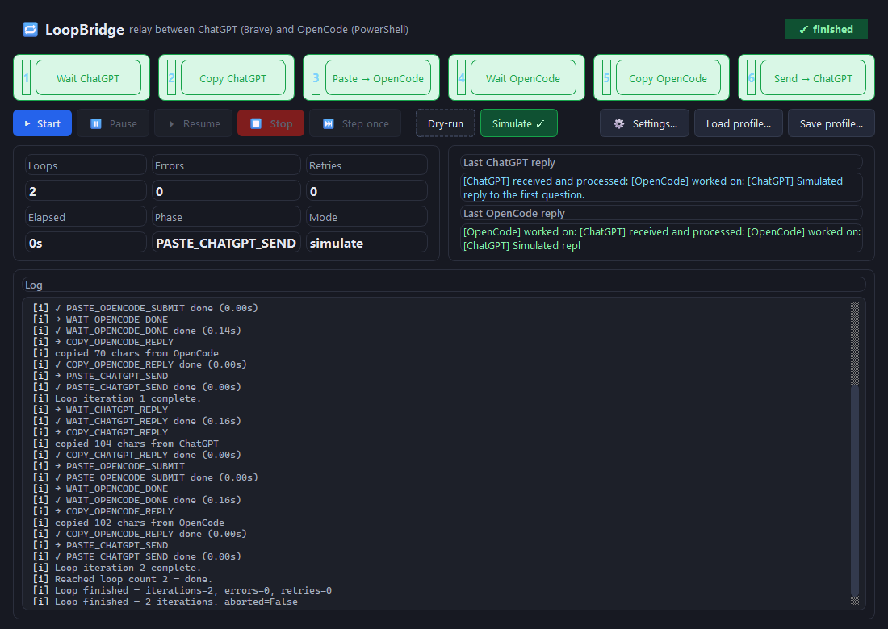
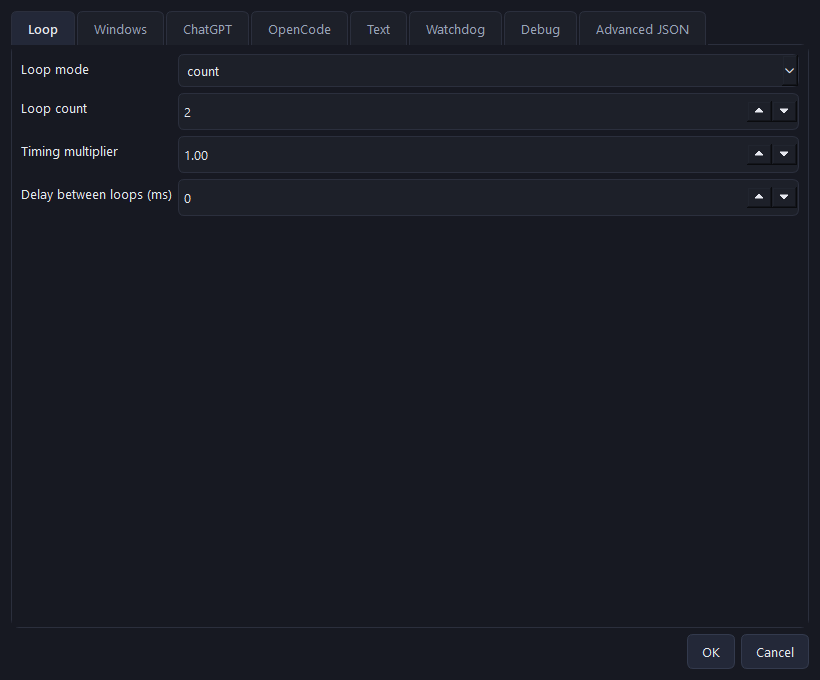
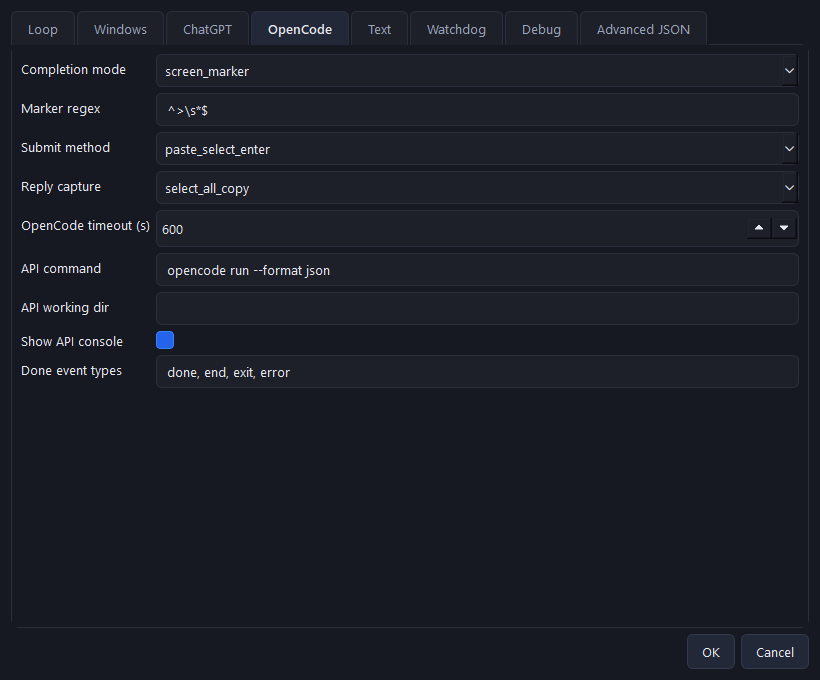

<p align="center">
  <picture>
    
  </picture>
</p>

# LoopBridge :: CHATGPT ↔ OPENCODE RELAY

**A Windows 11 desktop tool that relays replies between ChatGPT in Brave and OpenCode in a PowerShell window — automatically, in a loop.**

<p align="center">
  <a href="https://github.com/Nortaq-PlayNexus/LoopBridge/actions/workflows/ci.yml"></a>
  <a href="LICENSE"></a>
  
  
  
  
  
</p>

<pre>
IDENT ......... PHNT-011
CLASS ......... DESKTOP RELAY / AUTOMATION
STATUS ........ v1.0.0 — WORKING
PLATFORM ...... WINDOWS 11
STACK ......... PYTHON · PYSIDE6 · UIAUTOMATION · CDP
MODES ......... REAL · SIMULATE · DRY-RUN · GUI
LINK .......... /LoopBridge
</pre>

---

## // 01 :: SIGNAL

LoopBridge is the **middleman** between two AI tools you already run:

- **ChatGPT** open in the **Brave** browser
- **OpenCode** running in a **PowerShell / Windows Terminal** window

It runs a relay loop:

```
COPY ChatGPT reply
  → PASTE + SELECT + SUBMIT into OpenCode
  → WAIT for OpenCode to finish
  → COPY the OpenCode reply
  → PASTE + SEND into ChatGPT
  → LOOP
```

It **does not call any model API itself**. There are no keys, no accounts, no
cloud service. It drives the windows you have open, with three interchangeable
driver technologies, a watchdog, retries, and a dashboard that shows every hop.

---

## // 02 :: THE RELAY

One iteration is six phases. Each phase runs under its own deadline.

| # | Phase | What happens |
|---|---|---|
| 1 | `WAIT_CHATGPT_REPLY` | Polls until the latest ChatGPT generation is finished |
| 2 | `COPY_CHATGPT_REPLY` | Clicks ChatGPT's copy button, or falls back to select-all |
| 3 | `PASTE_OPENCODE_SUBMIT` | Focuses the terminal, pastes, selects, submits |
| 4 | `WAIT_OPENCODE_DONE` | Waits for a screen marker, a stable clipboard, or an API event |
| 5 | `COPY_OPENCODE_REPLY` | Selects and copies the reply out of the terminal |
| 6 | `PASTE_CHATGPT_SEND` | Focuses Brave, pastes into the composer, sends |

Every hop is logged. Every phase is guarded by a timeout. Failures retry with
backoff; if retries run out the loop aborts cleanly (or continues, if you set
`watchdog.continue_on_error`).

### Screenshots

| Dashboard — idle | Dashboard — after a simulated run |
|---|---|
|  |  |

| Settings — loop | Settings — OpenCode driver |
|---|---|
|  |  |

<sub>Real screenshots of the PySide6 UI, captured by `scripts/capture_screenshots.py`.</sub>

---

## // 03 :: QUICK START

### Prerequisites

- **Windows 11** for real window driving
- **Python 3.10+**
- **Brave** open on ChatGPT, with a reply already generated
- **PowerShell / Windows Terminal** running `opencode` inside your project

### Install

```powershell
pip install -r requirements.txt
```

### Rehearse first (no windows touched, runs anywhere)

```powershell
python run.py --simulate --count 2
```

### Real run (drives your real windows)

```powershell
python run.py                 # infinite loop
python run.py --count 5       # exactly 5 iterations
python run.py --dry-run       # act through the loop but never send
```

### Desktop UI

```powershell
python run.py --gui
```

The dashboard gives you Start / Pause / Resume / Stop / Step once, Dry-run and
Simulate toggles, a six-card phase stepper, live stats, reply previews, a
colour-coded log, and a tabbed settings editor for every option.

---

## // 04 :: RUN MODES

| Mode | Command | Windows touched? | Sends text? | Use it for |
|---|---|---|---|---|
| **Real** | `python run.py` | yes | yes | The actual relay |
| **Counted** | `python run.py --count 5` | yes | yes | Bounded runs |
| **Dry-run** | `python run.py --dry-run` | focus only | no | Verifying window targeting |
| **Simulate** | `python run.py --simulate` | no | no | Rehearsing the full loop anywhere |
| **GUI** | `python run.py --gui` | yes | yes | Driving and watching the loop |

CLI flags: `--profile PATH`, `--count N`, `--simulate`, `--dry-run`, `--gui`.

---

## // 05 :: CONFIGURATION

Everything lives in [`loopbridge-profile.json`](loopbridge-profile.json) and is
editable from **⚙ Settings…** in the GUI (Loop · Windows · ChatGPT · OpenCode ·
Text · Watchdog · Debug · Advanced JSON).

The options that matter most:

| Option | Default | Meaning |
|---|---|---|
| `chatgpt.copy_method` | `autocopy_button` | `autocopy_button`, `select_all`, or `cdp` |
| `chatgpt.send_key` | `enter` | `enter`, `ctrl_enter`, or `custom` |
| `opencode.completion_mode` | `screen_marker` | `screen_marker`, `clipboard_noop`, or `api` |
| `opencode.submit` | `paste_select_enter` | Paste, select all, then Enter |
| `opencode.capture` | `select_all_copy` | How the OpenCode reply is copied |
| `windows.*.title_regex` | see profile | How the Brave / PowerShell windows are found |
| `watchdog.*` | see profile | Per-phase timeouts, retries, backoff |
| `debug.dry_run` | `false` | Act but do not actually send |

Full reference: [`docs/configuration.md`](docs/configuration.md).

### CDP mode for ChatGPT (most robust)

Launch Brave with a debugging port, then set `chatgpt.copy_method = "cdp"`:

```powershell
brave.exe --remote-debugging-port=9222
```

The CDP driver evaluates JavaScript in the ChatGPT page directly — far less
fragile than UIA tree-poking when the UI changes.

### API mode for OpenCode (exact completion)

Set `opencode.completion_mode = "api"`. LoopBridge then runs
`opencode run --format json "<prompt>"` itself, streams the JSON events, and
treats process exit or a configured `done` event as completion. This replaces
terminal driving with an exact, scriptable signal.

---

## // 06 :: DRIVERS

Each side of the relay is behind a small interface, so the loop engine is
independent of the automation technology.

| Driver | Side | How it works | When to use |
|---|---|---|---|
| `UiaChatGPTDriver` | ChatGPT | UIA tree + keyboard | Default, no browser flags |
| `CdpChatGPTDriver` | ChatGPT | DevTools Protocol JS | ChatGPT UI drift breaks UIA |
| `UiaOpenCodeDriver` | OpenCode | Terminal text + clipboard | Default interactive TUI |
| `ApiOpenCodeDriver` | OpenCode | `opencode run --format json` | Exact completion, long replies |
| `Mock*Driver` | both | In-memory simulation | Tests, `--simulate` |

---

## // 07 :: ARCHITECTURE

```
loopbridge/
├── run.py                      # launcher (console or GUI)
├── loopbridge-profile.json     # default profile (all custom options)
├── requirements.txt
├── pyproject.toml
├── loopbridge/
│   ├── __main__.py             # CLI: --simulate / --count / --dry-run / --gui
│   ├── app.py                  # driver factory + console runner
│   ├── core/
│   │   ├── orchestrator.py     # ★ relay state machine + LoopController
│   │   ├── state.py            # Phase enum, RunStats
│   │   ├── watchdog.py         # per-phase deadlines (PhaseGuard)
│   │   ├── text_engine.py      # clipboard, ANSI/markdown sanitising
│   │   └── errors.py           # typed LoopError hierarchy
│   ├── drivers/
│   │   ├── window_manager.py   # find/focus Brave + PowerShell (UIA)
│   │   ├── chatgpt_ui.py       # ChatGPT via keyboard/UIA (default)
│   │   ├── chatgpt_cdp.py      # ChatGPT via CDP in-page JS
│   │   ├── opencode_tui.py     # OpenCode TUI driver (default)
│   │   ├── opencode_api.py     # OpenCode via `opencode run --format json`
│   │   └── mock.py             # simulated drivers (tests / --simulate)
│   ├── config/profiles.py      # profile dataclasses + JSON load/save
│   └── ui/                     # PySide6 dashboard, settings, tray, theme
├── docs/                       # architecture, configuration, security, API
├── scripts/                    # screenshot + social-preview generators
└── tests/                      # loop tests + headless GUI smoke test
```

The orchestrator runs on a worker thread; the GUI talks to it through
thread-safe signals and the `LoopController` (start / pause / resume / stop /
step once). The console runner uses the same orchestrator without Qt.

More: [`docs/architecture.md`](docs/architecture.md).

---

## // 08 :: TESTING

```powershell
python tests/test_loop.py
```

Covers the full relay loop, pause/stop, watchdog retry + abort, ANSI
sanitising, and dry-run behaviour — no Windows required.

```powershell
$env:QT_QPA_PLATFORM="offscreen"; python tests/smoke_gui.py
```

Builds the dashboard, opens the settings dialog, runs a simulated loop, and
checks phases, stats, reply previews, and the status pill.

CI runs both on `windows-latest` for Python 3.10–3.12.

---

## // 09 :: BUILD A STANDALONE EXE

```powershell
pip install pyinstaller
pyinstaller --noconfirm --windowed --name LoopBridge --onefile ^
  --collect-submodules loopbridge run.py
```

The executable lands in `dist/`. See [`docs/deployment.md`](docs/deployment.md)
for packaging notes.

---

## // 10 :: HONEST LIMITATIONS

- **Real window driving is Windows-only.** `--simulate` runs anywhere; real UIA
  driving requires Windows 11.
- **UIA drivers are best-effort against live UIs.** ChatGPT and OpenCode can
  change their layouts. If that happens, switch to CDP / API mode rather than
  patching selectors blindly.
- **Terminal capture copies the visible window text.** Very long replies can be
  truncated; use API mode when you need guaranteed full text.
- **OpenCode's JSON event schema may change between versions.** The API parser
  is deliberately defensive; adjust `opencode.done_event_types` if needed.
- **Dry-run still focuses windows.** It does not paste or send, but it will
  bring the target window forward. Use `--simulate` to touch nothing at all.
- **OpenCode permission prompts can stall a run.** Pre-configure
  `opencode.json` permissions; the watchdog will alert or abort otherwise.
- **This is a pipe, not a validator.** LoopBridge relays text verbatim (after
  sanitising); it does not check whether either model's answer is correct.
- **No automated UI integration test against the real ChatGPT/Brave app.** The
  tests use mock drivers and the headless Qt dashboard. The real drivers were
  built against current UIs and should be re-checked after UI updates.
- **CDP mode exposes a local debugging port.** Only enable it on your own
  machine and close it when you are done.

---

## // 11 :: LEGAL / RESPONSIBLE USE

LoopBridge is a **personal automation tool**. It does not bypass paywalls,
authentication, or rate limits; it types into windows you are already using.

- Use it only with accounts and services you own or are authorized to automate.
- Respect the terms of service of ChatGPT/OpenAI, Brave, OpenCode, and any other
  software you drive.
- Do not use it for spam, harassment, unauthorized access, or evading safeguards.
- No warranty. You are responsible for what the loop sends and for any
  consequences of running unattended automation.

---

## LICENSE

[MIT](LICENSE) © 2026 DJ PhantomTape / Nortaq-PlayNexus

## DOCS

[Architecture](docs/architecture.md) ·
[Configuration](docs/configuration.md) ·
[Development](docs/development.md) ·
[Deployment](docs/deployment.md) ·
[Security](docs/security.md) ·
[Python API](docs/api.md) ·
[Changelog](CHANGELOG.md) ·
[Contributing](CONTRIBUTING.md)
